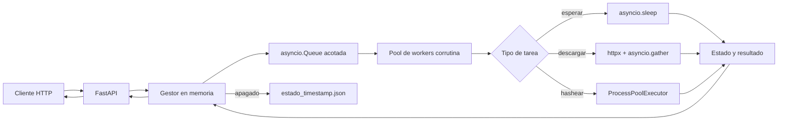

# Trabajo Práctico N.º 2 - Plataforma de tareas concurrentes

Computación II - Universidad de Mendoza

## Descripción

Este proyecto implementa una API HTTP con FastAPI para crear, consultar y
cancelar tareas concurrentes. La aplicación mantiene una cola acotada en
memoria, distribuye el trabajo entre corrutinas y separa el trabajo de CPU del
event loop mediante un `ProcessPoolExecutor`.

Los tres tipos de tarea disponibles son:

- `descargar`: descarga varias URLs concurrentemente y devuelve estado HTTP,
  tamaño y tiempo de cada respuesta.
- `hashear`: aplica SHA-256 repetidas veces sin bloquear la API.
- `esperar`: realiza una espera asíncrona, útil para observar estados,
  cancelaciones y timeouts.

Los estados posibles son `pendiente`, `ejecutando`, `completada`, `fallida` y
`cancelada`.

## Ejecución

Se necesita Docker Desktop o Docker Engine con Compose. Desde esta carpeta:

```bash
docker compose up --build
```

La API queda disponible en `http://localhost:8000` y la documentación
interactiva en `http://localhost:8000/docs`. Para apagarla ordenadamente:

```bash
docker compose down
```

### Configuración

Las variables se pueden modificar en `docker-compose.yml`:

| Variable | Valor inicial | Uso |
|---|---:|---|
| `TASK_WORKERS` | 3 | Corrutinas que consumen la cola |
| `TASK_CPU_WORKERS` | 2 | Procesos para tareas de hash |
| `TASK_QUEUE_SIZE` | 100 | Cantidad máxima de tareas en espera |
| `TASK_SHUTDOWN_TIMEOUT` | 10 | Segundos máximos de espera al apagar |
| `TASK_STATE_DIR` | `/app/estado` | Directorio de los volcados JSON |

### Ejemplos con curl

Crear una espera y guardar el `id` devuelto:

```bash
curl -X POST http://localhost:8000/tareas -H "Content-Type: application/json" -d '{"tipo":"esperar","segundos":5,"timeout":10}'
```

Crear un hash iterado:

```bash
curl -X POST http://localhost:8000/tareas -H "Content-Type: application/json" -d '{"tipo":"hashear","texto":"Computacion II","iteraciones":500000,"timeout":30}'
```

Crear una descarga concurrente:

```bash
curl -X POST http://localhost:8000/tareas -H "Content-Type: application/json" -d '{"tipo":"descargar","urls":["https://example.com","https://httpbin.org/get"],"timeout":30}'
```

Consultar, filtrar, cancelar y obtener estadísticas:

```bash
curl http://localhost:8000/tareas
curl "http://localhost:8000/tareas?estado=completada"
curl http://localhost:8000/tareas/ID
curl -X DELETE http://localhost:8000/tareas/ID
curl http://localhost:8000/estadisticas
```

El `POST` solamente valida, registra y encola: no espera el resultado. La tarea
se consulta después con su `id`.

## Arquitectura



Flujo de una tarea:

1. FastAPI valida el cuerpo y el gestor crea un registro.
2. El identificador entra a `asyncio.Queue` con `put_nowait`.
3. Un worker cambia el estado a `ejecutando` y aplica el timeout.
4. El ejecutor elige la estrategia según el tipo de tarea.
5. El worker guarda resultado o error y pasa al estado final correspondiente.
6. Al apagar, se deja de aceptar trabajo, se espera con un límite y se vuelca
   el estado a JSON.

## Decisiones de diseño

### `asyncio.Queue` en lugar de `queue.Queue`

La API y sus workers trabajan en un mismo event loop. `asyncio.Queue` permite
que una corrutina espere sin bloquear el hilo del loop y encaja directamente
con `async`/`await`. `queue.Queue` está pensada para threads y sus esperas
bloqueantes congelarían el loop si se usaran directamente. La cola es acotada:
si llega al límite, el `POST` responde `503` en vez de consumir memoria sin
límite.

No hace falta un `Lock` para actualizar los registros porque este código se
ejecuta en un único hilo y una corrutina sólo cede el control en un `await`.
Los cambios de estado que deben ser atómicos se realizan sin un `await` en el
medio.

### Trabajo CPU-bound

El hash iterado es CPU-bound. Ejecutarlo dentro de una corrutina bloquearía el
único hilo del event loop, impidiendo que FastAPI atienda otras peticiones.
Por eso se envía con `run_in_executor` a un `ProcessPoolExecutor`. Se eligieron
procesos y no threads porque el cálculo se realiza en Python y los procesos
permiten paralelismo de CPU separado del GIL.

### Descargas concurrentes

Se reutiliza un `httpx.AsyncClient` y se crea una corrutina por URL. Un
`asyncio.gather` las espera juntas, por lo que durante la espera de red otras
descargas pueden avanzar. Un `for` que hiciera `await` de cada descarga antes de
crear la siguiente las volvería secuenciales.

Cada URL conserva su resultado o error. Si fallan todas, la tarea completa pasa
a `fallida`; si alguna responde, se devuelve la lista para mostrar también los
fallos parciales.

### Cancelación, timeout y errores

Cada ejecución es una `asyncio.Task`. Al cancelar una tarea pendiente se marca
como `cancelada` y el worker la descarta al retirarla de la cola. Si ya está en
ejecución, se llama a `cancel()` sobre su corrutina. Esto interrumpe limpiamente
`asyncio.sleep` y las esperas HTTP; el cliente HTTP compartido se cierra en el
ciclo de vida de la aplicación.

`asyncio.wait_for` aplica el timeout individual. Al vencer, cancela la espera y
el registro pasa a `fallida` con el motivo. Si el ejecutor lanza cualquier otra
excepción, el worker la captura, la registra y marca sólo esa tarea como
`fallida`; el worker sigue disponible para la siguiente. La excepción especial
es una operación CPU que ya comenzó en otro proceso: cancelar la corrutina evita
esperar su resultado, pero el cálculo puede seguir hasta finalizar. Esta
limitación se informa en el campo `error`.

### Apagado y persistencia

Uvicorn recibe `SIGINT` o `SIGTERM` y ejecuta el `lifespan` de FastAPI. El gestor
deja de aceptar tareas, espera `queue.join()` hasta el límite configurado,
cancela lo que no terminó, cierra workers, cliente HTTP y pool de procesos, y
genera `estado/estado_<timestamp>.json`. Al iniciar se busca el último volcado
y se lo informa por log. El estado sigue siendo en memoria: el archivo es un
informe del apagado, no una base de datos ni una restauración de la cola.

## Mediciones

Las pruebas se hicieron el 2 de noviembre de 2026 dentro de la imagen Docker
del proyecto. Los scripts están en `mediciones/` y se pueden repetir con:

```bash
docker compose run --rm api python -m mediciones.io_descargas
docker compose run --rm api python -m mediciones.event_loop
docker compose run --rm api python -m mediciones.techo_pool
```

Los tiempos pueden variar según la computadora, pero los siguientes son los
resultados obtenidos en esta ejecución.

### 1. Concurrencia de I/O

Se usó un servidor HTTP local controlado que demora 100 ms por respuesta para
evitar que la red externa altere la comparación.

| 20 descargas | Tiempo |
|---|---:|
| Secuenciales | 2,1212 s |
| Concurrentes | 0,1274 s |
| Speedup | 16,65x |

Las concurrentes tardaron cerca de la respuesta más lenta y no de la suma. El
speedup no llega exactamente a 20x por el costo de conexiones, planificación y
procesamiento de las respuestas.

### 2. Event loop bloqueado

Se ejecutaron 1.500.000 iteraciones de SHA-256 mientras se enviaba un
`GET /tareas` a la aplicación real mediante ASGI.

| Caso | Latencia de `GET /tareas` | Duración del trabajo CPU |
|---|---:|---:|
| Hash directo en el event loop | 0,7930 s | 0,8432 s |
| Hash en `ProcessPoolExecutor` | 0,0102 s | 0,5838 s |

Sin executor, la respuesta HTTP queda detenida casi todo lo que dura el hash.
Con executor, el event loop puede atenderla mientras otro proceso calcula. La
duración del hash no es el dato principal; lo importante es que la latencia de
la API bajó aproximadamente 78 veces.

### 3. Techo del pool

Se configuraron 16 workers de corrutina pero sólo 2 procesos CPU. Cada tarea
realizó 250.000 iteraciones y se enviaron mediante la API.

| Tareas simultáneas | Tiempo total | Tiempo por tarea | Completadas |
|---:|---:|---:|---:|
| 1 | 0,2550 s | 0,2550 s | 1 |
| 2 | 0,2786 s | 0,1393 s | 2 |
| 4 | 0,5045 s | 0,1261 s | 4 |
| 8 | 0,6893 s | 0,0862 s | 8 |
| 16 | 1,6637 s | 0,1040 s | 16 |

El límite de ejecución CPU simultánea es 2, que es el tamaño del pool; las
demás tareas avanzan por tandas. Entre 8 y 16 tareas la carga se duplicó pero el
tiempo total aumentó unas 2,41 veces y también empeoró el tiempo por tarea. Ahí
se observa la degradación por espera en el pool y costos de planificación. Tener
16 workers asíncronos no crea 16 CPU disponibles.

## Conceptos del curso aplicados

- **Clase 17, multiplexación de I/O:** el event loop alterna corrutinas cuando
  una operación de red queda esperando.
- **Clase 18, concurrencia y paralelismo:** se diferencia I/O-bound, resuelto
  con corrutinas, de CPU-bound, enviado a procesos. Las mediciones comparan
  ambas estrategias.
- **Clase 19, APIs asíncronas:** FastAPI expone recursos HTTP sin ejecutar el
  trabajo largo dentro del `POST`.
- **Clase 20, I/O asíncrono de red:** `httpx.AsyncClient` y `asyncio.gather`
  permiten descargar varias URLs de forma concurrente.
- **Clase 21, colas y pools:** la API es el productor y los workers son los
  consumidores de una `asyncio.Queue` compartida y acotada.
- **Clase 22, futuros, cancelación y errores:** cada ejecución tiene una
  `asyncio.Task`, timeout, cancelación y conversión de excepciones a estados.

El modelo también corresponde al patrón productor-consumidor visto en la
materia, pero con corrutinas en lugar de threads. La sincronización se basa en
los puntos `await` y en la cola del event loop.

## Pruebas

La suite automatizada se ejecuta en el mismo entorno Linux de entrega:

```bash
docker compose run --rm api python -m unittest discover -s tests -v
```

Incluye creación y consulta, filtro, estadísticas, `POST` inmediato,
cancelación pendiente y en ejecución, timeout, excepción, cola llena, descargas
concurrentes, fallo total de descargas, hash en el executor y persistencia. En
la verificación final pasaron 12 pruebas, incluida la cancelación de tareas
largas cuando vence el límite de apagado.

También se verificó manualmente que Compose expone la API al host, una tarea
pasa de `pendiente` a `completada`, el apagado crea el JSON y el siguiente
arranque informa el volcado anterior.

## Limitaciones conocidas

- Los registros no se restauran al iniciar; sólo se informa el último volcado.
- No hay autenticación, prioridades, rate limiting ni base de datos.
- La cola y el diccionario viven en una sola instancia; no se distribuyen entre
  varios contenedores.
- Una función que ya corre en `ProcessPoolExecutor` no se puede interrumpir de
  forma segura con `Task.cancel()` y puede ocupar el proceso hasta terminar.
- No se limita por separado la cantidad de URLs dentro de una tarea de descarga.
- El tiempo y el tamaño de las respuestas dependen del servidor remoto.

## Lo que aprendí

Antes de este trabajo relacionaba concurrencia principalmente con ejecutar
varias cosas a la vez. Al implementarlo entendí mejor que el tipo de trabajo
define la herramienta: `asyncio` aprovecha las esperas de I/O, pero no vuelve
paralelo un cálculo pesado. La medición del event loop fue la demostración más
clara, porque una sola función de hash ejecutada en el lugar incorrecto hizo
que una petición sencilla quedara esperando.

También aprendí que cancelar no consiste solamente en cambiar un estado. Hay
que conservar la referencia a la ejecución, propagar la cancelación y liberar
los recursos al apagar. Me resultó importante descubrir la diferencia entre
cancelar una corrutina que espera y un cálculo que ya comenzó en otro proceso,
porque la API puede dejar de esperarlo pero eso no detiene automáticamente el
trabajo de CPU.

Por último, las mediciones me ayudaron a no suponer que agregar más workers
siempre mejora el rendimiento. La cola permite controlar la carga y mantener
la API estable, pero el pool de procesos tiene un techo real. A partir de ese
punto, las tareas se acumulan y aparecen costos de espera y planificación que
se ven en los tiempos.
